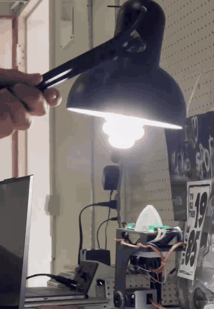
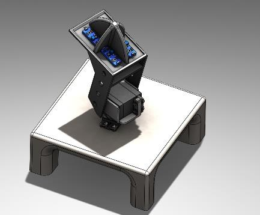
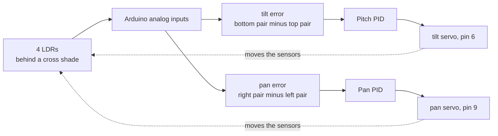
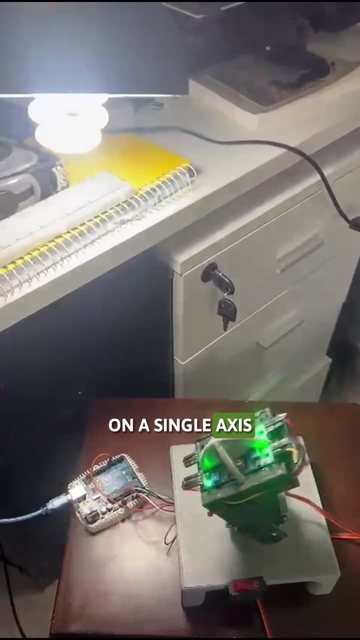
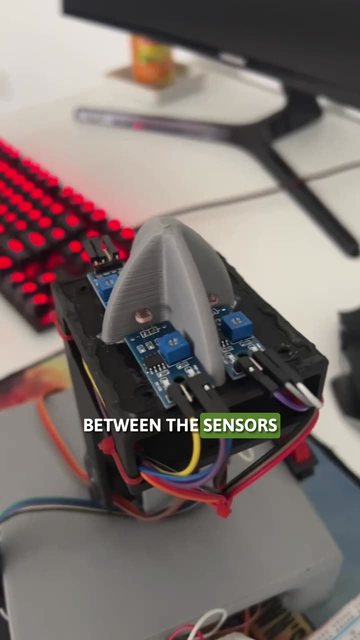
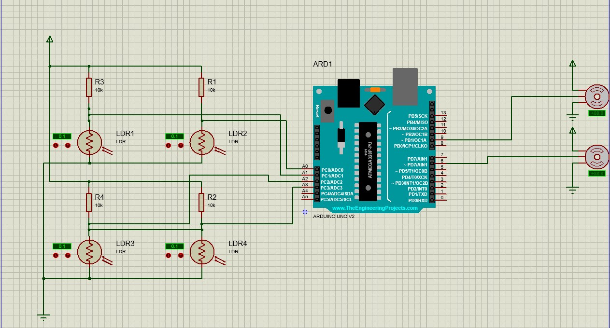

# PID light tracker

A two-axis Arduino robot that turns to face a light source, built so I could watch a PID loop overshoot, jitter and settle in front of me.


<p align="center">
  
</p>

## What it is

The goal is simple: measure where the light is, move two servos, and keep the light centred. That simplicity is the point. With nothing else going on, every control problem is visible: too much proportional gain and it oscillates, too little and it hesitates, integral action that keeps building while a servo is already at its limit, derivative action that turns sensor noise into jitter.

I built it in fall 2024 at RHU with Wassim Ghaddar, as team Brainiacs. I led the software and the system architecture; Wassim handled the hardware integration and testing.

## Highlights

- Two MG995 servos for pan and tilt, driven by an Arduino Uno.
- Four light-dependent resistors (LDRs) split into quadrants by a printed shade, so each axis sees a difference in light.
- A small PID class I wrote for this (`src/tracker.h`), with separately tuned gains and output limits per axis.
- All gains, pins and limits in one file, `src/config.h`.
- SolidWorks CAD, a Proteus simulation of the circuit, and the final report in the repository.

<p align="center">
  
</p>

## How it works



1. **Sense.** Each LDR sits in a voltage divider with a 10 kΩ resistor. The shade means a light that is off-centre lights some quadrants more than others.
2. **Tilt.** The sketch averages the two bottom sensors and the two top sensors. The difference is the tilt error, which goes into the pitch PID. The output is clamped to between -70 and +55 degrees and written to the tilt servo as an offset from its 90 degree centre.
3. **Pan.** The same again with the right pair against the left pair, clamped to plus or minus 90 degrees. When the tilt servo is on the far side of its centre, the sensors face the other way and left and right swap, so the pan output is flipped.
4. **Repeat** every 10 ms.

The two axes have different gains (pan Kp 0.075, Ki 0.00045, Kd 0.00035; tilt Kp 0.03, Ki 0.00018, Kd 0.00035) because they move different masses with different friction. Servo backlash, limited travel and the frame flexing are inside the loop, not outside it.

| The prototype: one axis first, then two | The two-axis build up close |
|:---:|:---:|
| [](https://ramikronbi.com/projects/pid-light-tracking-robot) | [](https://ramikronbi.com/projects/pid-light-tracking-robot) |

The clips play on the [project page](https://ramikronbi.com/projects/pid-light-tracking-robot), and the full demo is on [YouTube](https://youtu.be/Ye032oekX0A).

## Hardware

| Part | Qty | Role |
|------|:---:|------|
| Arduino Uno | 1 | Runs both PID loops |
| MG995 servo | 2 | Pan and tilt |
| LDR (light-dependent resistor) | 4 | Light sensing, one per quadrant |
| 10 kΩ resistor | 4 | One divider per LDR |
| Printed base, servo bracket, tilt mount, shade | 1 set | Frame, from `CAD-models/` |
| Servo supply (about 6 V) | 1 | Power for the servos, separate from USB |

### Wiring



The servos are on pins 9 (pan) and 6 (tilt). The Proteus simulation wires the four dividers to A0 to A3; the sketch reads top-right on A0, bottom-right on A2, bottom-left on A3 and top-left on A5. Whatever you wire, set the same pins in `src/config.h`.

## Running it

1. Arduino IDE expects a sketch to live in a folder with the same name, so copy the three files in `src/` into a folder called `tracker/`.
2. Open `tracker/tracker.ino`. The only library it needs is `Servo`, which ships with the IDE.
3. Select Arduino Uno, upload, and open the Serial Monitor at 9600 baud to see the start-up messages.
4. The servos centre at 90 degrees, wait a second, then start tracking. Point a lamp at it and move it slowly.
5. To retune, change the gains and limits in `src/config.h`. Tune one axis at a time.

The CAD files open in SolidWorks. The circuit opens in Proteus (`proteus-simulation/simulation.pdsprj`).

## Repository layout

```
.
├── CAD-models/           SolidWorks parts and assembly
├── project-report/       Final Report.pdf
├── project-video/        YouTube link (the local video is stored with Git LFS)
├── proteus-simulation/   Proteus circuit
├── src/
│   ├── config.h          pins, gains, limits, timing
│   ├── tracker.h         PID controller class, Pan and Pitch
│   └── tracker.ino       the sketch
└── docs/media/           images for this README
```

The full write-up of the build is the [final report](project-report/Final%20Report.pdf).

## Limits and what's next

- PID tuning is specific to this frame. The gains here will not carry over to different servos or a heavier head.
- The sketch reads raw sensor values. Sensor noise can turn derivative action into jitter unless it is filtered; `config.h` already has settings for smoothing, a dead-band and an integral limit, but the sketch does not use them yet.
- The integral term is not bounded, only the output is, so it can wind up while a servo sits at its limit.

Next would be wiring in that filtering and anti-windup, and running the loop on a fixed timer instead of a delay.

## Links and credits

- Project page: [ramikronbi.com/projects/pid-light-tracking-robot](https://ramikronbi.com/projects/pid-light-tracking-robot)
- Write-up: [What a two-axis light tracker teaches about PID control](https://ramikronbi.com/writing/what-a-two-axis-light-tracker-teaches-about-pid-control)
- Demo video: [YouTube](https://youtu.be/Ye032oekX0A)

Team Brainiacs, RHU, fall 2024:

- **Rami Kronbi** ([@Kronbii](https://github.com/Kronbii)): software and system architecture
- **Wassim Ghaddar**: hardware integration and testing

Released under the MIT License, see [`LICENSE`](LICENSE).

Built by Rami Kronbi — [ramikronbi.com](https://ramikronbi.com)
